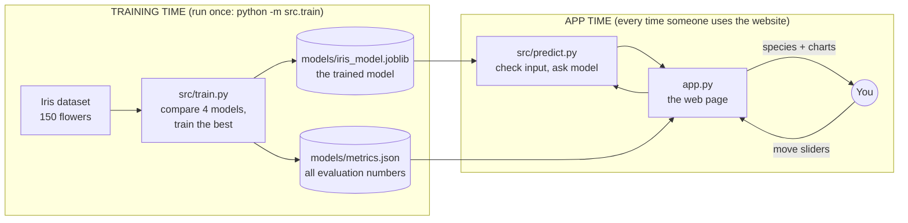
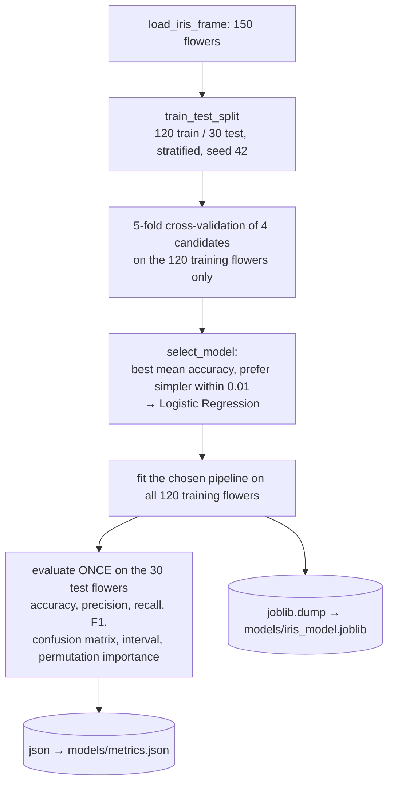
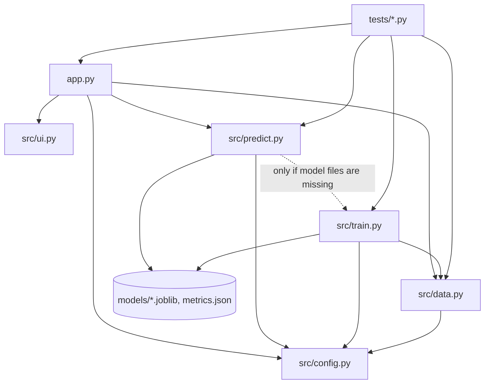

# Project Walkthrough: Iris Species Classifier

A beginner-friendly guide to **every file** in this project: what it does, how its important functions
work, and how a flower's measurements travel from the web page to the final prediction.

Everything here describes the code as it exists in this repository. Numbers marked as *real* were produced
by running the actual saved model.

**How to read this:** Sections 1–3 give the big picture. Section 4 is a map of all files. Section 5 explains
each file in detail. Sections 6 and 7 trace the two main flows step by step: *using the website* and *training
the model*. Section 9 is a glossary you can return to at any time.

---

## Contents
1. [The project in one minute](#1-the-project-in-one-minute)
2. [Five ideas you need first](#2-five-ideas-you-need-first)
3. [The two halves of the project: training time and app time](#3-the-two-halves-of-the-project-training-time-and-app-time)
4. [Map of every file](#4-map-of-every-file)
5. [File-by-file explanation](#5-file-by-file-explanation)
6. [End-to-end flow: from your slider to the prediction](#6-end-to-end-flow-from-your-slider-to-the-prediction)
7. [Training flow: what `python -m src.train` does](#7-training-flow-what-python--m-srctrain-does)
8. [How the files depend on each other](#8-how-the-files-depend-on-each-other)
9. [Glossary](#9-glossary)

---

## 1. The project in one minute

The app answers one question: **"Given four measurements of an iris flower, which of three species is it?"**
The three species are *Iris setosa*, *Iris versicolor* and *Iris virginica*.

- You open a web page, move four sliders (sepal length, sepal width, petal length, petal width, all in cm), and the page shows the predicted species, how sure the model is, and some charts explaining why.
- Behind the page is a **machine-learning model**. *Machine learning (ML)* means a program learns a rule from examples instead of a programmer writing the rule by hand. A *model* is the learned rule, stored as numbers in a file.
- The model learned from **Fisher's Iris dataset**: 150 real flowers, measured in the 1930s, each labelled with its correct species.

Analogy: a botanist who has studied 120 labelled flowers can guess the species of a new flower from its
measurements. The model does the same thing, using arithmetic.

---

## 2. Five ideas you need first

| Idea | Plain meaning | In this project |
|---|---|---|
| **Feature** | One input measurement the model looks at | The 4 measurements, e.g. `petal_length` |
| **Label** (also *target* or *class*) | The correct answer the model should learn to predict | The species: 0 = setosa, 1 = versicolor, 2 = virginica |
| **Training** | Showing the model labelled examples so it can adjust its internal numbers | Done once by `src/train.py` |
| **Prediction** (also *inference*) | Using the trained model on new input to get an answer | Done every time you move a slider, by `src/predict.py` |
| **Classification** | A prediction task where the answer is a category, not a number | Choosing one of 3 species |

This is **supervised learning**: learning from examples that come *with* the correct answers.

---

## 3. The two halves of the project: training time and app time

The project has two separate moments.



- **Training time** happens once. It reads the data, learns, and **saves** two files into `models/`.
- **App time** happens whenever the website runs. The app **loads** the saved files; it does *not* retrain on every visit.

The trained model is already included in `models/`, so you can run the app straight away. If those files are
ever missing, the app trains automatically on start-up (see `ensure_trained` in §5.4).

---

## 4. Map of every file

```
iris-flower-classification/
├── app.py                  ← the website (Streamlit app): layout, sliders, charts
├── src/                    ← the "engine": all data and ML logic
│   ├── __init__.py         ← empty file; marks src/ as a Python package so "from src import ..." works
│   ├── config.py           ← shared settings: file paths, feature names, colours, limits
│   ├── data.py             ← loads the Iris dataset into a table
│   ├── train.py            ← trains and evaluates models, saves the best one
│   ├── predict.py          ← checks user input and asks the saved model for a prediction
│   └── ui.py               ← small styling helpers (banner, result card, footer)
├── models/
│   ├── iris_model.joblib   ← the trained model, saved to disk
│   └── metrics.json        ← every number the website shows about model quality
├── assets/                 ← the three species photos + ATTRIBUTIONS.md (licences)
├── tests/
│   ├── test_model.py       ← automated checks of data, training and prediction code
│   └── test_app.py         ← automated checks of the website itself, without a browser
├── docs/                   ← MODEL_CARD.md, DEVELOPMENT_LOG.md, TESTING.md
├── .streamlit/config.toml  ← website theme (light and dark colours)
├── requirements.txt        ← exact list of Python libraries and versions to install
├── pytest.ini              ← settings for the test runner
├── .gitignore              ← files Git should not upload
└── README.md               ← overview and quick start
```

**Key rule of this design:** `app.py` decides *how things look*; everything in `src/` decides *what is
computed*. `src/predict.py` and `src/train.py` never import Streamlit (the web framework), so they can be
tested and reused without a web page.

---

## 5. File-by-file explanation

### 5.1 `src/config.py`: the single source of truth

A small file of constants (fixed values) that every other file imports. Keeping them in one place means
the training script, the website and the tests always agree.

| Constant | Value | Meaning |
|---|---|---|
| `ROOT`, `MODELS_DIR`, `MODEL_PATH`, `METRICS_PATH` | e.g. `models/iris_model.joblib` | Where files live. `Path(__file__).resolve().parents[1]` means "the folder above `src/`", so paths work no matter where you start Python |
| `FEATURES` | `["sepal_length", "sepal_width", "petal_length", "petal_width"]` | The 4 input columns, always in this order |
| `FEATURE_LABELS` | `"Sepal length (cm)"` … | Human-friendly names for the website |
| `SPECIES` | `["setosa", "versicolor", "virginica"]` | Position in this list = class number (0, 1, 2) |
| `SPECIES_COLORS` | amber, green, purple | Colour of each species in every chart |
| `MIN_CM`, `MAX_CM` | `0.0`, `30.0` | Hard limits: a value must be > 0 and ≤ 30 cm, otherwise it's treated as a typo |
| `RANDOM_STATE` | `42` | The *random seed*: a fixed starting number for anything random, so results are identical every run (*reproducible*) |
| `TEST_SIZE` | `0.2` | 20% of flowers are kept aside for the final exam (the *test set*) |
| `CV_FOLDS` | `5` | Number of rounds in cross-validation (explained in §5.3) |

---

### 5.2 `src/data.py`: loading the dataset

**One function: `load_iris_frame()`**

1. Calls scikit-learn's `load_iris(as_frame=True)`. *scikit-learn* is the main Python machine-learning
   library used in this project; it ships with the Iris dataset, so **no download is needed**.
2. Renames the columns from `"sepal length (cm)"` to `sepal_length` (easier to type in code).
3. Adds `target` (0/1/2) and `species` (the name).
4. Returns a **DataFrame**: a table object from the *pandas* library, like a spreadsheet in Python.

Real first three rows:

| | sepal_length | sepal_width | petal_length | petal_width | target | species |
|---|---|---|---|---|---|---|
| 0 | 5.1 | 3.5 | 1.4 | 0.2 | 0 | setosa |
| 1 | 4.9 | 3.0 | 1.4 | 0.2 | 0 | setosa |
| 2 | 4.7 | 3.2 | 1.3 | 0.2 | 0 | setosa |

Used by: `train.py` (to learn), `app.py` (for charts and the example buttons), and the tests.

---

### 5.3 `src/train.py`: learning and evaluating

Run with `python -m src.train`. (`-m` means "run this module as a program". It's needed so that the
`from src...` imports work.)

#### Function `build_candidates()`
Returns four **candidate models**: different learning algorithms we compare to find the best one.

| Name | Plain explanation |
|---|---|
| **Logistic Regression** | Gives each species a score that is a weighted sum of the measurements, then turns the three scores into probabilities. Simple and easy to inspect |
| **k-Nearest Neighbours (k = 5)** | Finds the 5 most similar training flowers and lets them vote |
| **Decision Tree (max depth 3)** | A flowchart of up to 3 yes/no questions such as "petal length ≤ 2.45 cm?" |
| **SVM (RBF kernel)** | *Support Vector Machine*: finds the widest possible boundary between species; the RBF kernel lets that boundary be curved |

Three of them are wrapped in a **Pipeline**: a chain of steps that runs in order as one object. Here the chain is:

```
StandardScaler  →  classifier
```

A **StandardScaler** performs *standardisation*: it rescales each feature so it has average 0 and spread 1,
using `z = (x − mean) / std`. *std* (standard deviation) measures how spread out values are. Without this,
features with bigger numbers would dominate distance-based models such as k-NN and SVM.

Why put the scaler *inside* the pipeline? Because then it learns its mean and std **only from the data it is
trained on**. If it learned them from all 150 flowers first, a little information from the test flowers would
leak into training. That mistake is called **data leakage**, and it makes results look better than they
really are.

The SVM is additionally wrapped in `CalibratedClassifierCV`. This gives it a `predict_proba` method (it
outputs probabilities); a plain SVM gives only a yes/no-style answer.

#### Function `select_model(cv_results)`
Chooses the winner with a rule written in code: **the best average score wins, but if several models are
within 0.01 (one percentage point) of the best, pick the one listed first**. Logistic Regression is listed
first because it is the simplest. A tiny score difference isn't worth a harder-to-explain model.

#### Function `accuracy_interval(correct, total)`
Computes a **95% confidence interval**: a range that very likely contains the model's "true" accuracy.
With only 30 test flowers, 28/30 correct gives the range 78.7%–98.2%. It uses the *Wilson* method from
the SciPy library, which works well for small samples.

#### Function `train_and_evaluate()`: the heart of training
Step by step (real results in brackets):

1. **Load** the 150 flowers with `load_iris_frame()`. `X` = the 4 feature columns, `y` = the `target` column.
2. **Split** with `train_test_split(..., test_size=0.2, stratify=y, random_state=42)`:
   - **Training set** = 120 flowers the model may learn from.
   - **Test set** = 30 flowers locked away for the final exam.
   - *Stratify* = keep the same species mix in both parts (exactly 10 of each species in the test set).
3. **Cross-validate** each candidate using `StratifiedKFold(5)` and `cross_val_score`:
   - **Cross-validation (CV)** = split the 120 training flowers into 5 equal groups (*folds*). Train on 4 folds, score on the 5th, and repeat 5 times so every fold is used once for scoring. Average the 5 scores.
   - This lets us compare models fairly **without touching the test set**.
   - Real results: Logistic Regression 0.958, k-NN 0.958, Decision Tree 0.958, SVM 0.967 (mean accuracy).
4. **Select** with `select_model` → **Logistic Regression** (the SVM is ahead by only 0.009, within the 0.01 tolerance).
5. **Fit** (train) the chosen pipeline on all 120 training flowers: `candidates[chosen].fit(X_train, y_train)`.
6. **Test once** on the 30 locked-away flowers: `model.predict(X_test)`.
7. **Permutation importance**: shuffle one measurement column of the test set (30 times) and see how much accuracy drops. A big drop means the model relies on that measurement. *(Real: petal width 0.216, petal length 0.190, sepal width 0.052, sepal length 0.021.)*
8. **Record mistakes**: every test flower whose prediction was wrong (real: 2 flowers, rows 77 and 134).
9. **Training statistics**: min and max of each feature, and each species' average. The website uses these for warnings and comparison charts.
10. Build the `metrics` dictionary (a Python key → value structure) containing everything above.

The evaluation numbers it calculates:
- **Accuracy** = correct predictions ÷ all predictions *(real: 0.933 = 28/30)*.
- **Precision** for a species = of the flowers we *called* that species, the share that really were.
- **Recall** for a species = of the flowers that *really were* that species, the share we found.
- **F1-score** = one number that balances precision and recall (their harmonic mean).
- **Macro average** = compute the metric for each species, then take the plain average.
- **Confusion matrix** = a table of actual species (rows) vs predicted species (columns). Numbers on the diagonal are correct predictions. *(Real: `[[10,0,0],[0,9,1],[0,1,9]]`.)*

#### Function `main()`
Calls `train_and_evaluate()`, then **saves**:
- the model with `joblib.dump(...)` → `models/iris_model.joblib`. *joblib* turns a Python object into a file and back. Saving an object like this is called *serialisation*.
- the metrics with `json.dumps(...)` → `models/metrics.json`. *JSON* is a plain-text format for structured data.

It then prints a summary like this (real output):
```
Cross-validation accuracy (training set):
  Logistic Regression            0.958 +/- 0.026
  k-Nearest Neighbours (k=5)     0.958 +/- 0.026
  Decision Tree (max depth 3)    0.958 +/- 0.026
  SVM (RBF kernel)               0.967 +/- 0.017
Selected model: Logistic Regression
Test accuracy: 0.933 | macro F1: 0.933
```

`if __name__ == "__main__": main()` at the bottom means: run `main()` only when this file is started
directly, not when another file imports it.

---

### 5.4 `src/predict.py`: from user input to an answer

This file has no Streamlit code, so the tests can call it directly.

| Function | What it does |
|---|---|
| `ensure_trained()` | If `iris_model.joblib` or `metrics.json` is missing, runs `train.main()` to create them. This is why a fresh copy of the project still works |
| `load_model()` | `joblib.load(...)`: reads the saved model file back into memory |
| `load_metrics()` | Reads `metrics.json` into a Python dictionary |
| `validate_measurements(values)` | Checks each of the 4 inputs and returns a list of error messages (an empty list means OK). Rejects missing values, non-numbers, NaN or infinity (*NaN* = "not a number"), values ≤ 0 cm and values > 30 cm |
| `out_of_range_warnings(values, train_min, train_max)` | Returns gentle warnings (not errors) for values outside the range seen during training. Predicting outside that range is called **extrapolation**: the model is guessing beyond its experience |
| `to_frame(values)` | Turns the `{feature: value}` dictionary into a 1-row DataFrame with the columns in the correct order, which is the shape the model expects |
| `predict_species(model, values)` | **The main prediction function** (see below) |
| `decision_grid(model, sepal_length, sepal_width)` | Builds a 150 × 150 grid of petal sizes, asks the model to predict every point, and returns the result for the "decision map" chart |

**`predict_species` step by step:**
1. `validate_measurements(values)`: if there are errors, it raises a `ValueError`, which the app catches and shows in red.
2. `model.predict_proba(to_frame(values))[0]`: the model returns three probabilities, e.g. `[0.005, 0.825, 0.170]`.
3. `np.argmax(proba)` finds the position of the biggest probability (here 1, which is `versicolor`).
4. It returns a dictionary:
   ```python
   {"species": "versicolor", "confidence": 0.825,
    "probabilities": {"setosa": 0.005, "versicolor": 0.825, "virginica": 0.170}}
   ```

**`decision_grid` in plain words:** the model uses 4 measurements, but a chart has only 2 axes. So the
function keeps your two sepal values fixed and varies petal length (0.5–7.5 cm) and petal width (0–2.8 cm)
across a 150 × 150 grid (22,500 imaginary flowers), then records which species the model predicts for each.
The coloured regions on the chart are these predictions. The lines between regions are the model's
**decision boundaries**: the places where its answer switches from one species to another.

---

### 5.5 `src/ui.py`: presentation helpers

| Function | Purpose |
|---|---|
| `inject_css()` | Adds a little CSS (web styling code) for the coloured banner, result card and footer. Uses semi-transparent colours so it works in light and dark mode |
| `hero(title, subtitle, badges)` | Draws the purple banner at the top, plus the hint on how to switch light/dark mode |
| `result_card(label, value, sub, color)` | Draws the "Predicted species" box |
| `footer(text)` | The small line at the bottom |
| `style_fig(...)`, `NEUTRAL`, `PLOT_MARGIN` | Defined here but not currently used by `app.py` (the app sets its chart styling directly) |

All text is passed through `html.escape(...)` so that symbols like `<` are shown as text, never run as code.

---

### 5.6 `app.py`: the website

The website is built with **Streamlit**, a Python library that turns a Python script into an interactive web
page. When you run `python -m streamlit run app.py`, Streamlit starts a small local web server at
http://localhost:8501.

**The most important thing to know about Streamlit:** every time you touch a *widget* (an interactive control
such as a slider or button), Streamlit **re-runs the whole `app.py` script from top to bottom** and redraws
the page. Two tools keep this fast and consistent:

- **Caching**: `@st.cache_resource` on `get_model_and_metrics()` and `@st.cache_data` on `get_data()` mean the model, metrics and dataset are loaded **once** and reused on every rerun.
- **Session state**: `st.session_state` is a per-visitor memory that survives reruns. The slider values are stored there under keys like `in_petal_length`.

**Functions in `app.py`:**

| Function | Role |
|---|---|
| `get_model_and_metrics()` | Cached. Calls `ensure_trained()`, then loads the model and metrics |
| `get_data()` | Cached. Loads the dataset for the charts and example buttons |
| `apply_preset(df, row)` | Runs when you click an example button: copies that real flower's 4 measurements into session state, so the sliders jump to them |
| `render_inputs(df)` | Draws the 4 example buttons (Typical setosa = row 0, Typical versicolor = row 50, Typical virginica = row 100, Borderline case = row 83) and the 4 sliders (0.1–10.0 cm, step 0.1). Returns the current values as a dictionary |
| `render_result(result, values, metrics)` | Draws the result card with a confidence note (≥ 85% → "confident", ≥ 60% → "fairly confident", otherwise "uncertain"), the probability bar chart, the species photo, and extrapolation warnings |
| `render_explanations(model, df, values, metrics)` | Draws the decision map (`decision_grid` + all 150 real flowers + your flower as a pink star) and a bar chart comparing your measurements with each species' average |
| `render_model_card(metrics)` | Model card tab: accuracy, precision, recall, F1, the confidence interval, the model comparison chart, the confusion matrix, permutation importance, the per-species table and the misclassified flowers. **Every number comes from `metrics.json`** |
| `render_how_it_works(metrics)` | Explains the pipeline and the softmax formula |
| `render_dataset(df)` | Species photos, a scatter matrix (every pair of features plotted against each other), summary statistics and the raw data table |
| `main()` | Builds the page: page settings → load model and data (with a friendly error if that fails) → default slider values (row 50) → banner → 4 tabs → footer |

The charts are drawn with **Plotly**, a library for interactive charts (hover, zoom).

---

### 5.7 `tests/`: automatic checks

Run with `python -m pytest`. *pytest* is a tool that finds functions named `test_...` and runs them; a test
passes if none of its `assert` statements fail.

**`tests/test_model.py`** (15 test cases):
- `test_dataset_shape_and_balance`: 150 rows, the right columns, no missing values, 50 per species.
- `test_saved_metrics_match_saved_model`: recomputes accuracy from the saved model and checks it equals the number stored in `metrics.json`, so the website can't show a wrong number.
- `test_model_quality_floor`: test accuracy is at least 0.90.
- `test_known_examples` (3 cases): three known flowers get the correct species, and the probabilities sum to 1.
- `test_invalid_inputs_are_rejected` (6 cases): negative, zero, 99 cm, text, NaN and missing values are all rejected.
- `test_out_of_range_warning`, `test_decision_grid_shape`, `test_selection_prefers_simpler_model_on_near_tie`.

A **fixture** (`@pytest.fixture`) prepares something once for several tests, here the loaded model and
metrics. `@pytest.mark.parametrize` runs one test with several different inputs.

**`tests/test_app.py`** (3 tests) uses Streamlit's **AppTest**, which runs `app.py` without a browser and lets
the test click buttons and move sliders:
- all 4 tabs render and a prediction appears;
- clicking "Typical setosa" shows *Iris setosa*, and "Typical virginica" shows *Iris virginica*;
- setting petal length to 9.5 shows the "Outside the training data" warning.

---

### 5.8 Data, model and configuration files

| File | What it is |
|---|---|
| `models/iris_model.joblib` | The trained Pipeline (scaler + logistic regression), about 2 KB |
| `models/metrics.json` | Every evaluation number, CV results, training min/max and species averages |
| `assets/*.jpg` + `ATTRIBUTIONS.md` | Illustrative photos only: the model never sees images. Licences are listed in the `.md` file |
| `.streamlit/config.toml` | Colours for light and dark mode; enables the theme switch in the ⋮ menu |
| `requirements.txt` | Exact library versions (e.g. `scikit-learn==1.9.1`), so everyone installs the same thing |
| `pytest.ini` | Tells pytest to look in `tests/` and to treat the project folder as the import root |
| `.gitignore` | Tells Git not to upload caches, virtual environments and personal notes |

---

## 6. End-to-end flow: from your slider to the prediction

When you open the page, it shows dataset row 50 by default: **sepal 7.0 × 3.2 cm, petal 4.7 × 1.4 cm** (a real
*versicolor*). Here is exactly what happens, with **real numbers**:

```mermaid
sequenceDiagram
    participant You
    participant App as app.py (Streamlit)
    participant Pred as src/predict.py
    participant Model as Saved Pipeline<br/>(scaler + logistic regression)
    You->>App: open page / move a slider
    App->>App: rerun script; model and data come from the cache
    App->>App: render_inputs() reads 4 slider values
    App->>Pred: predict_species(model, values)
    Pred->>Pred: validate_measurements() → no errors
    Pred->>Model: predict_proba(1-row table)
    Model->>Model: 1) scale  2) score  3) softmax
    Model-->>Pred: [0.005, 0.825, 0.170]
    Pred-->>App: species = versicolor, confidence = 0.825
    App->>Pred: out_of_range_warnings(), decision_grid()
    App-->>You: result card, probability bars, photo, decision map, comparison chart
```

**Step 1. Read the inputs.** `render_inputs()` returns
`{"sepal_length": 7.0, "sepal_width": 3.2, "petal_length": 4.7, "petal_width": 1.4}`.

**Step 2. Validate.** `validate_measurements()` checks that each value is a number in (0, 30]. All pass, so the
error list is empty. *(If you sent 0 cm, it would return "Sepal length (cm) must be greater than 0 cm." and
the page would show it in red.)*

**Step 3. Make a 1-row table.** `to_frame()` creates a DataFrame with the columns in `FEATURES` order.

**Step 4. Inside the model, part 1: scaling.** The saved StandardScaler applies `z = (x − mean) / std`, using
the mean and std it learned from the 120 training flowers:

| Feature | x | mean | std | z |
|---|---|---|---|---|
| sepal length | 7.0 | 5.842 | 0.837 | **1.383** |
| sepal width | 3.2 | 3.048 | 0.447 | **0.340** |
| petal length | 4.7 | 3.770 | 1.761 | **0.528** |
| petal width | 1.4 | 1.205 | 0.759 | **0.257** |

**Step 5. Inside the model, part 2: one score per species.** Logistic regression computes, for each
species *k*, `score_k = w_k · z + b_k`: a weighted sum of the four z-values plus a constant. The weights
`w` and constants `b` were learned during training. Real scores: setosa **−2.847**, versicolor **2.213**,
virginica **0.634**.

**Step 6. Inside the model, part 3: softmax.** **Softmax** turns scores into probabilities that are all
positive and add up to 1: `P(k) = e^{score_k} / (e^{score_setosa} + e^{score_versicolor} + e^{score_virginica})`.
Real result: setosa **0.5%**, versicolor **82.5%**, virginica **17.0%**.

**Step 7. Pick the answer.** `argmax` picks versicolor. Its confidence is 0.825, which is between 0.6 and 0.85,
so the card says *"Fairly confident, but virginica is also plausible."*

**Step 8. Extra checks and explanations.**
- `out_of_range_warnings()`: all 4 values lie inside the training range (e.g. petal length 1.1–6.9 cm), so there is no warning. *(With petal length 9.5 you would see: "Petal length (cm) = 9.5 cm is outside the training range (1.1–6.9 cm).")*
- `decision_grid(model, 7.0, 3.2)`: 22,500 grid predictions colour the decision map (real counts for these sepal values: 82 setosa, 15,619 versicolor, 6,799 virginica), and your flower appears as a star.
- The comparison chart reads the species averages from `metrics.json`.

**Step 9. Draw the page.** Streamlit sends the finished page to your browser. Moving any slider repeats
steps 1–9 in a fraction of a second; the model is not reloaded, thanks to caching.

**Clicking an example button** first runs `apply_preset()`, which overwrites the slider values in
`st.session_state`. The script then reruns and the same steps produce the new prediction (e.g. *Typical
setosa* → setosa, 98.1%).

---

## 7. Training flow: what `python -m src.train` does



Why this order matters:
- The **test set** is like a final exam paper: it must not be seen while choosing or training the model, otherwise the score is too optimistic.
- **Cross-validation** is the practice exams used to pick the best model.
- **Overfitting** (memorising the training examples instead of learning the general pattern) is detected by checking performance on data the model hasn't seen.

---

## 8. How the files depend on each other

An arrow means "imports / uses".



- `config.py` imports nothing from the project, so it is the foundation.
- `predict.py` imports `train.py` *only inside* `ensure_trained()`, and only when the model files are missing.
- The **saved files** in `models/` are the hand-over point between training and the app.

---

## 9. Glossary

| Term | Simple meaning |
|---|---|
| **Accuracy** | Share of predictions that are correct |
| **AppTest** | Streamlit tool that runs the app in a test without a browser |
| **argmax** | The position of the largest value in a list |
| **Caching** | Remembering a result so it isn't recomputed every time |
| **Class / label / target** | The correct answer category (here, the species) |
| **Classification** | Predicting a category |
| **Confidence interval** | A range that very likely contains the true value of an uncertain estimate |
| **Confusion matrix** | Table of actual vs predicted classes; the diagonal holds the correct ones |
| **Cross-validation (CV)** | Repeatedly training on part of the training data and scoring on the rest, to compare models fairly |
| **Data leakage** | Accidentally letting information from evaluation data influence training, which makes scores look too good |
| **DataFrame** | A table object from pandas |
| **Decision boundary** | Where the model's prediction changes from one class to another |
| **Decision tree** | A model made of yes/no questions |
| **Extrapolation** | Predicting for inputs outside the range seen in training |
| **F1-score** | One number balancing precision and recall |
| **Feature** | One input value the model uses |
| **Fixture (pytest)** | Shared setup for tests |
| **Fold** | One of the equal parts in cross-validation |
| **Hyperparameter** | A setting chosen before training (e.g. k = 5 neighbours, tree depth 3), not learned from data |
| **joblib** | Library for saving Python objects to files and loading them back |
| **JSON** | Plain-text format for structured data |
| **k-Nearest Neighbours (k-NN)** | Predicts by majority vote of the k most similar training examples |
| **Logistic regression** | Linear scores per class, turned into probabilities with softmax (for 3 classes) |
| **Machine learning** | Programs that learn rules from examples |
| **Macro average** | Average of a metric computed separately for each class |
| **Model** | The learned rule, stored as numbers |
| **NaN** | "Not a Number": a missing or undefined numeric value |
| **Overfitting** | Learning the training examples too specifically, so the model does worse on new data |
| **Permutation importance** | How much the score drops when one feature's values are shuffled |
| **Pipeline** | Several processing steps chained into one object |
| **Precision** | Of the items predicted as a class, the share that truly belong to it |
| **Prediction / inference** | Using a trained model on new input |
| **Probability** | A number from 0 to 1 expressing how likely something is |
| **Random seed (`random_state`)** | Fixed starting number for randomness, so results are reproducible |
| **Recall** | Of the items truly in a class, the share the model found |
| **Rerun (Streamlit)** | Streamlit runs the whole script again after every interaction |
| **scikit-learn** | The Python machine-learning library used here |
| **Serialisation** | Saving an in-memory object to a file |
| **Session state** | Streamlit's per-visitor memory that survives reruns |
| **Softmax** | Turns scores into probabilities that sum to 1 |
| **Standardisation / StandardScaler** | Rescaling a feature to mean 0 and spread 1 |
| **Stratified split** | A split that keeps the class proportions equal in each part |
| **Supervised learning** | Learning from examples that include the correct answers |
| **SVM (Support Vector Machine)** | Finds the widest boundary between classes; the RBF kernel lets it curve |
| **Test set** | Data kept aside and used once, at the end, to measure performance |
| **Training set** | Data the model learns from |
| **Widget** | An interactive web control (slider, button) |
