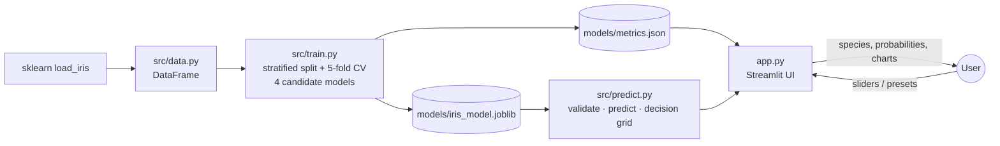

# 🌸 Iris Species Classifier

An interactive machine-learning web application that identifies the species of an iris flower
(_setosa_, _versicolor_ or _virginica_) from four measurements, and explains how it reached its decision.

**Author:** Arya Kumar · AI/ML internship project

---

**Live Demo:** https://iris-flower-classification-jwwj.streamlit.app/

---

## Problem statement

Identifying plant species by eye takes expertise. Fisher's Iris dataset (1936) records four simple
measurements for 150 flowers from three closely related species. The task is to learn a function that
maps those four numbers to the correct species, and to present it in a form that a non-specialist can use
and trust appropriately.

### Objectives

1. Train and compare several classification algorithms with a leakage-free, reproducible pipeline.
2. Select a model with a clear, documented rule and evaluate it once on held-out test data.
3. Build an interactive application that shows the prediction, its confidence, and a visual explanation.
4. Communicate the model's limitations honestly (for example, extrapolation and the closed set of species).

## Features

| Area                      | What it does                                                                                                         |
| ------------------------- | -------------------------------------------------------------------------------------------------------------------- |
| **Predict**               | Sliders for the four measurements; one-click real examples, including a genuinely ambiguous flower                   |
| **Result**                | Predicted species, probability for every species, and a plain-language confidence note                               |
| **Decision map**          | The model's decision regions over petal length × petal width, with your flower marked as a star                      |
| **Comparison**            | Your measurements next to the average of each species                                                                |
| **Extrapolation warning** | Flags any value outside the range seen during training                                                               |
| **Model card**            | Real test metrics, confusion matrix, 5-fold CV comparison of 4 models, permutation importance, misclassified flowers |
| **How it works**          | The pipeline, the softmax equation, and what the model can and cannot tell you                                       |
| **Dataset**               | Species photo gallery (illustrative), interactive scatter matrix, summary statistics, raw data and source            |
| **Light / dark mode**     | Both themes supported (⋮ menu → Settings → Theme)                                                                    |

Every number in the app is read from `models/metrics.json`, which is written by the training script.
Nothing is hard-coded.

## Technology stack

| Layer             | Tool                                                                                                      |
| ----------------- | --------------------------------------------------------------------------------------------------------- |
| Language          | Python 3.13                                                                                               |
| Machine learning  | scikit-learn 1.9 (Pipeline, StandardScaler, LogisticRegression, cross-validation, permutation importance) |
| Data              | pandas, NumPy                                                                                             |
| Web application   | Streamlit 1.66                                                                                            |
| Charts            | Plotly (interactive)                                                                                      |
| Model persistence | joblib                                                                                                    |
| Testing           | pytest + Streamlit `AppTest` (headless app tests)                                                         |

## Dataset

**Fisher's Iris dataset**: 150 samples, 50 per species, 4 numeric features (cm), no missing values.
It is loaded with `sklearn.datasets.load_iris()`, so **no download is required**. scikit-learn's copy follows
Fisher's original paper; the UCI copy contains two transcription errors.

- Source: R. A. Fisher (1936), _The use of multiple measurements in taxonomic problems_, Annals of Eugenics 7(2).
- Licence: UCI Machine Learning Repository, CC BY 4.0. Distributed with scikit-learn (BSD-3-Clause).

## Architecture



## Quick start (Windows PowerShell)

Requires **Python 3.11 or newer** (tested with 3.13.1 on Windows 11). Run these from a PowerShell window:

```powershell
# 1. Go to the project folder (the one containing app.py)
cd path\to\iris-flower-classification

# 2. First time only: create a virtual environment and install the dependencies
py -3.13 -m venv C:\venvs\iris
C:\venvs\iris\Scripts\Activate.ps1
python -m pip install -r requirements.txt

# 3. Every time: activate the environment and start the app
C:\venvs\iris\Scripts\Activate.ps1
python -m streamlit run app.py
```

The app opens at **http://localhost:8501**. Stop it with `Ctrl + C`. Run the tests with `python -m pytest`
(18 tests).

- **Data:** No download needed: the dataset ships with scikit-learn.
- **Model:** The trained model (`models/iris_model.joblib`) is included. Retrain (a few seconds): `python -m src.train`.
- **Light / dark mode:** open the **⋮** menu (top right) → **Settings** → **Theme**.

> The virtual environment is created at a short path outside the project folder on purpose: inside a long
> OneDrive path, Windows' 260-character path limit can break the installation (`WinError 206`), and
> OneDrive would sync ~500 MB of packages. If `py -3.13` is not available, use `python -m venv C:\venvs\iris`.

### Common startup problems

| Symptom                                                                    | Fix                                                                                                                          |
| -------------------------------------------------------------------------- | ---------------------------------------------------------------------------------------------------------------------------- |
| `Activate.ps1 cannot be loaded because running scripts is disabled`        | Run `Set-ExecutionPolicy -Scope Process -ExecutionPolicy Bypass`, then activate again (affects this window only)             |
| `streamlit` / `python` is not recognised, or `ModuleNotFoundError`         | The environment is not active: run the `Activate.ps1` line again; always start the app with `python -m streamlit run app.py` |
| `ModuleNotFoundError: No module named 'src'`                               | You are not in the project folder; `cd` into the folder that contains `app.py`                                               |
| `Port 8501 is already in use`                                              | Another app is running; stop it, or use `python -m streamlit run app.py --server.port 8502`                                  |
| `WinError 206: The filename or extension is too long` during `pip install` | Create the environment at a short path such as `C:\venvs\iris` (as above)                                                    |
| The browser does not open                                                  | Open http://localhost:8501 manually                                                                                          |

## How to use

1. Open the **Predict** tab. Click **Typical setosa**, **Typical versicolor** or **Typical virginica** to load a real flower.
2. Click **Borderline case** to see a real versicolor that the model finds ambiguous (about 53% virginica vs 47% versicolor).
3. Move the sliders and watch the star move across the decision map.
4. Push a slider beyond the training range, for example petal length 9 cm, to see the extrapolation warning.
5. Open **Model card** to see how the model was chosen and how it performed.

## Results (held-out test set, 30 flowers)

| Metric                        | Value                                                    |
| ----------------------------- | -------------------------------------------------------- |
| Selected model                | Multinomial Logistic Regression (with standard scaling)  |
| Test accuracy                 | **93.3%** (28 / 30); 95% confidence interval 78.7%–98.2% |
| Macro precision / recall / F1 | 0.933 / 0.933 / 0.933                                    |
| Setosa F1                     | 1.00                                                     |
| Versicolor / Virginica F1     | 0.90 / 0.90                                              |

5-fold cross-validation accuracy on the training set (mean ± std):

| Model                              | CV accuracy   |
| ---------------------------------- | ------------- |
| **Logistic Regression** (selected) | 0.958 ± 0.026 |
| k-Nearest Neighbours (k=5)         | 0.958 ± 0.026 |
| Decision Tree (max depth 3)        | 0.958 ± 0.026 |
| SVM (RBF kernel)                   | 0.967 ± 0.017 |

The SVM scored highest, but it is within the 0.01 tolerance and the selection rule prefers the simpler,
more interpretable model on near-ties. The difference amounts to one flower in 120. Both test errors are
versicolor/virginica confusions; setosa is always identified correctly. Permutation importance confirms
that **petal width and petal length** drive the predictions.

## Repository structure

```
iris-flower-classification/
├── app.py                  # Streamlit UI (4 tabs)
├── requirements.txt        # pinned dependencies
├── pytest.ini              # test configuration
├── .streamlit/config.toml  # theme
├── src/
│   ├── config.py           # paths, feature names, constants
│   ├── data.py             # dataset loading
│   ├── train.py            # model comparison, training, evaluation, saving
│   ├── predict.py          # validation, prediction, decision-region grid
│   └── ui.py               # styling helpers (banner, result card)
├── assets/                 # illustrative species photos + ATTRIBUTIONS.md (CC BY-SA)
├── models/
│   ├── iris_model.joblib   # trained pipeline (scaler + classifier)
│   └── metrics.json        # every number the app displays
├── tests/
│   ├── test_model.py       # data, training, prediction and validation tests
│   └── test_app.py         # headless Streamlit tests
└── docs/
    ├── MODEL_CARD.md       # exact model, method, results and limitations
    ├── DEVELOPMENT_LOG.md  # what was done and why
    └── TESTING.md          # test strategy and results
```

## Limitations

- **Closed-set classifier**: it always answers with one of three species, even for a different flower.
- **Small dataset**: 150 flowers from one study. Test accuracy on 30 flowers moves in steps of 3.3%.
- **Extrapolation**: values outside the training range are flagged but still predicted.
- **Decision map is a 2-D slice**: the sepal values are held fixed at the user's input.

## Future improvements

- Add an explicit "unknown" option (for example, a distance-to-training-data threshold).
- Load measurements from a CSV file for batch prediction.
- Use repeated cross-validation or bootstrapping to report a confidence interval for accuracy.

## Documentation

- [Model card](docs/MODEL_CARD.md): exact implementation, evaluation and limitations
- [Development log](docs/DEVELOPMENT_LOG.md)
- [Testing](docs/TESTING.md)
